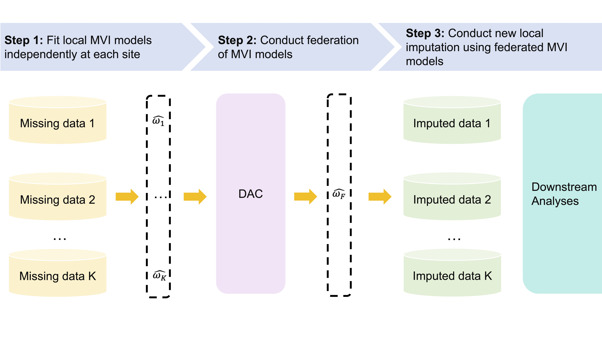

# FedIMPUTE: Privacy-Preserving Missing Value Imputation for Multi-site Heterogeneous Electronic Health Records

[](https://doi.org/10.1016/j.jbi.2025.104780)
[](https://github.com/siqili0325/FedScore-ShinyApp)
[](https://www.r-project.org/)

This repository contains the official R implementation for **FedIMPUTE**, a communication-efficient federated learning (FL) approach for privacy-preserving missing value imputation (MVI) in multi-site, heterogeneous electronic health records (EHRs).

<p align="center">
  
</p>

> **🔗 Interactive application.** FedIMPUTE is available as the optional federated missing-value imputation step in the [**FedScore Shiny app**](https://github.com/siqili0325/FedScore-ShinyApp) — a point-and-click tool for building interpretable, [AutoScore](https://github.com/nliulab/AutoScore)-style clinical risk scores across sites that exchange only summary statistics. The app includes a demo that begins from this imputation step.

---

## 📌 Overview

Missing data is pervasive in electronic health records, yet imputing it across hospitals raises two challenges:
1. **Data-sharing constraints:** patient-level records cannot leave each site, so imputation models must be trained without pooling data.
2. **Population heterogeneity:** case mix, missingness rates, and sample sizes differ across sites, so a single shared imputation model can degrade downstream prediction.

**FedIMPUTE** addresses both. It first performs missing value imputation locally at each site, then federates the local imputation models through a range of FL strategies—from basic to advanced—without sharing site-specific data. The federated models are broadcast back to each site for final imputation. Across simulation studies and a real-world application to emergency department (ED) outcomes using EHRs from three hospitals in the Duke University Health System (DUHS), FedIMPUTE achieved the lowest mean squared error (MSE) among benchmark MVI methods and improved—or matched—downstream risk-prediction performance, with the largest gains at sites that have high missingness and small sample sizes.

---

## ✍️ Citation

If you find FedIMPUTE useful for your research, please cite:

```bibtex
@article{li2025fedimpute,
  title   = {FedIMPUTE: Privacy-preserving missing value imputation for multi-site heterogeneous electronic health records},
  author  = {Li, Siqi and others},
  journal = {Journal of Biomedical Informatics},
  year    = {2025},
  doi     = {10.1016/j.jbi.2025.104780}
}
```

---

## 👥 Contact

* **Siqi Li** <siqili@u.duke.nus.edu>
